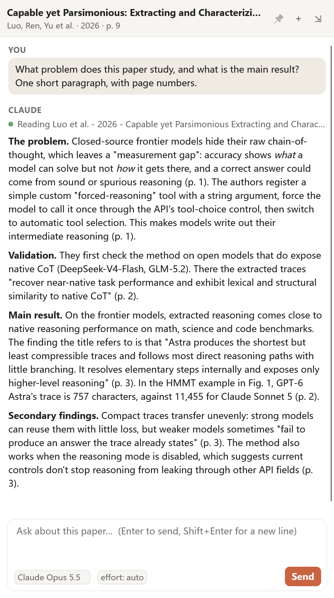

# Claude Code for Zotero

[English](README.md) | 中文

在 Zotero 里直接和你正在读的论文对话。插件调用你电脑上已经装好的 Claude Code 命令行，用你自己的 Claude 账号回答问题，默认模型是 Claude Opus 5.5。对话面板可以放在 Zotero 右侧的条目面板里，也可以拖出来变成独立窗口，放到另一块屏幕上。

<p align="center"></p>

本项目为个人开发的非官方插件，与 Anthropic 和 Zotero 官方均无关联。

## 能做什么

- 对话会跟着你正在读的论文走。切换阅读器标签页或阅读器窗口，对话也会自动切过去。每篇论文有自己独立的对话记录，重启 Zotero 后还在。
- Claude 自己读 PDF。每条消息都会告诉它文件路径和你当前所在的页码，它会按需打开相应页面。让它标注页码，它就会照做。
- 在 PDF 里选中一段文字，点弹出菜单里的"问 Claude"，就能针对这段话提问。
- 面板默认在条目面板里。把面板的标题栏拖出 Zotero 窗口，或者点"弹出"按钮，它就会变成独立窗口。阅读器工具栏上也有一个按钮，可以直接打开这个窗口。
- 输入框下方可以选择模型和推理强度。中途换模型，对话会接着进行，上下文不会丢。
- 默认情况下 Claude 只有读取权限：它可以打开文件、搜索文本、上网查资料，但不能修改文件，也不能执行命令。

## 环境要求

- Zotero 7 及以上版本。目前在 Windows 版 Zotero 10.0.6 上测试过。
- 已安装并登录的 Claude Code。使用 Claude Opus 5.5 需要 Claude Code 2.1.280 或更新的版本，不确定的话运行一次 `claude update`。

## 安装

1. 在 [Releases 页面](https://github.com/YufeiXIA/zotero-claude-code/releases) 下载最新的 `.xpi` 文件。
2. 在 Zotero 中打开 Tools > Plugins（工具 > 插件），点右上角的齿轮图标，选择 Install Plugin From File...（从文件安装），选中刚下载的 `.xpi` 文件。
3. 如果还没装 Claude Code，先到 <https://claude.com/claude-code> 安装，然后在终端里运行一次 `claude` 完成登录。
4. 打开任意一篇 PDF，点阅读器工具栏右侧的对话气泡图标即可开始。

插件会自动在常见位置查找 Claude Code：npm 全局安装目录、官方安装器的 `~/.local/bin`、Claude 桌面应用自带的版本，以及系统 `PATH`，并使用其中版本最新的那个。如果找错了，可以在 Zotero 设置的 Claude Code 页面里手动填写路径。

## 日常使用

按 Enter 发送，Shift+Enter 换行。用中文、日文等输入法打字时，按 Enter 确认候选词不会把消息发出去。

对话面板顶部的按钮：

| 按钮 | 作用 |
| --- | --- |
| 📌 | 固定在当前论文，打开别的论文时对话也不切换 |
| ＋ | 为当前论文开始一段新对话 |
| ⧉ / ⇲ | 把对话移到独立窗口，或者放回侧边栏 |

双屏用起来很顺手。在 Zotero 的 Settings > General > Reader（设置 > 常规 > 阅读器）里，勾选 "Open files in new windows instead of tabs"，也就是用新窗口而不是标签页打开文件。这样 PDF 会在独立窗口中打开。这样一块屏幕放阅读器，另一块屏幕放对话窗口。对话窗口会记住上次的位置。

也可以从菜单"工具 > Claude Code 对话"打开对话窗口。

## 设置

在 Zotero 设置里选择 Claude Code 页面。

| 设置项 | 默认值 | 说明 |
| --- | --- | --- |
| Claude Code 可执行文件 | 空 | 留空表示自动查找。点"自动查找"会显示找到的程序路径和版本。 |
| 模型 | `claude-opus-5-5` | 任何 Claude Code 支持的模型名都可以。对话框里的模型菜单也会修改这一项。 |
| 推理强度 | 空 | 可选 `low`、`medium`、`high`、`xhigh`、`max`。留空由 Claude Code 自己决定。 |
| 允许 Claude 直接使用的工具 | `Read,Grep,Glob,WebSearch,WebFetch` | 不在列表里的工具一律拒绝。 |
| 加载我的 Claude Code 用户设置 | 开 | 使用你 `~/.claude` 里的配置，包括 CLAUDE.md、MCP 服务器和权限规则。想要一个不带个人配置的干净助手，就关掉它。 |
| 每次对话附加的说明 | 空 | 会加到每段对话里，比如"请用中文回答"。 |
| 对话自动切换到我正在读的论文 | 开 | 关掉后，只有你手动选论文时对话才会切换。 |

改完设置后，从下一条消息开始生效，不需要重启 Zotero。

## 配合 LLM for Zotero 使用

如果你同时在用 [LLM for Zotero](https://github.com/yilewang/llm-for-zotero) 插件，可以把它的文献库工具也交给 Claude。做法是：先把它的 MCP 服务器注册到 Claude Code（`claude mcp add ...`，具体命令见该插件的文档），保持"加载我的 Claude Code 用户设置"开启，再把 `mcp__zotero` 加进允许的工具列表。之后 Claude 就能检索你的文献库、写笔记、在 PDF 上加高亮。删除条目、执行命令这类工具，放行前请先想清楚。

## 工作原理

每段对话对应一个 `claude -p` 进程，输入输出都使用 stream-json 格式，两条消息之间进程保持运行。空闲 15 分钟后进程会自动退出，下次发消息时再启动一个新进程，并通过 `--resume` 接上原来的 Claude Code 会话，对话内容不会丢失。

每条消息开头都附有一段简短的 `<zotero_context>`，包含标题、作者、年份、DOI、PDF 路径和你当前的页码。一段对话的第一条消息还会附上摘要。读取 PDF 用的是 Claude Code 自带的 Read 工具。插件会通过 `--add-dir` 允许 Claude 读取 Zotero 的存储目录，并使用 `--permission-mode dontAsk`：不在允许列表里的工具直接拒绝，而不是卡在一个没人能点的确认框上。

对话记录以 JSON 文件保存在 `<Zotero 数据目录>/claude-code/conversations/` 下。删除这个文件夹就能清空所有记录。

## 隐私与安全

中间没有任何第三方服务器。插件只和你电脑上的 `claude` 进程通信，Claude Code 再像你平时在终端里使用时一样连接 Anthropic。也就是说，你的消息、上下文信息，以及 Claude 读取的论文页面，都会以你的账号发送给 Anthropic。

Zotero 的界面代码拥有访问整台电脑的权限，所以插件从不把模型输出当作 HTML 插入页面。我们用一个小型 Markdown 渲染器逐个创建页面元素，文字一律通过 `textContent` 写入。链接会在浏览器中打开，并且只有 `http`、`https` 和 `mailto` 链接可以点击。

如果把 `Edit`、`Write` 或 `Bash` 加进允许的工具，Claude 就能不经确认直接修改文件或执行命令。除非你确实需要，否则不要这样做。

## 已知限制

- 数学公式目前以数学字体的纯文本显示，还没有排版渲染。
- 阅读器独立窗口（"在新窗口中打开"模式）里没有 Zotero 的条目面板，这种情况下请使用对话窗口。
- 目前只在 Windows 上测试过。macOS 和 Linux 的代码已经写好，但还没有验证，欢迎反馈。
- 如果你的 CLAUDE.md 给 Claude 设定了人设或个人规则，回答里也会体现出来。不想这样的话，关掉"加载我的 Claude Code 用户设置"即可。

## 从源码构建

```
python scripts/build.py
```

运行后会生成 `build/zotero-claude-code-<版本号>.xpi` 和 `build/update.json`。Zotero 通过 `update.json` 检查更新，所以发布时要把这两个文件都上传到标签为 `v<版本号>` 的 GitHub Release。

开发调试时不必每次打包。先关闭 Zotero，在 Zotero 配置目录的 `extensions` 文件夹里新建一个名为 `zotero-claude-code@yufeixia` 的文本文件，内容写本仓库 `addon` 文件夹的完整路径。再删掉配置目录下 `prefs.js` 里 `extensions.lastAppBuildId` 和 `extensions.lastAppVersion` 这两行，然后启动 Zotero，在 Tools > Plugins 里启用一次。之后每次改完代码，重启 Zotero 就能生效。

## 许可证

[MIT](LICENSE)
